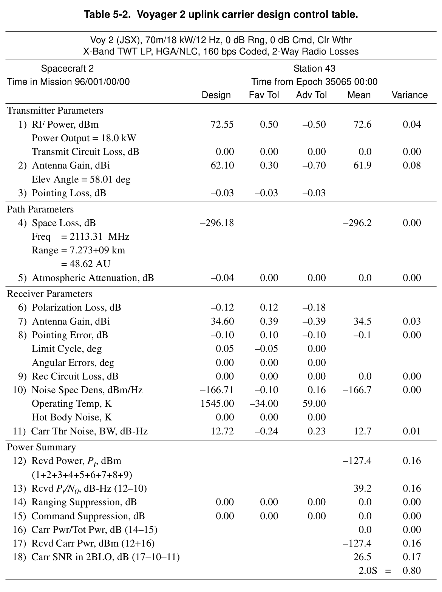
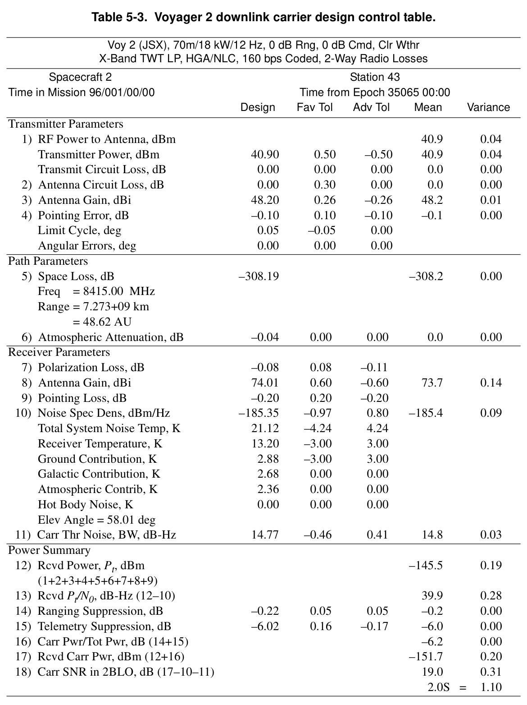
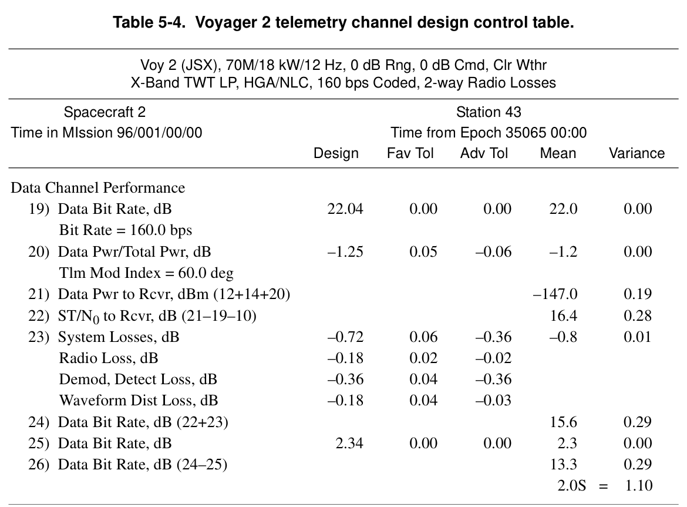

# ボイジャー テレコミュニケーション

**DESCANSO Design and Performance Summary Series — Article 4**

原題: *Voyager Telecommunications*
著者: Roger Ludwig / Jim Taylor
Jet Propulsion Laboratory, California Institute of Technology, Pasadena, California
National Aeronautics and Space Administration
2002年3月

> 本資料は、米航空宇宙局(NASA)ジェット推進研究所(JPL)が公表した技術文書
> 「Voyager Telecommunications」(DESCANSO Design and Performance Summary Series, Article 4)
> の内容を日本語に翻訳・要約したものである。原文はJPLのDESCANSO(Deep Space
> Communications and Navigation Systems)シリーズのウェブサイトで公開されている。
> 数値を多数列挙したリンク予算表の一部は、紙面の都合上代表的な値のみを抜粋している。

---

## ボイジャー:恒星間ミッション

木星、土星、天王星、海王星という太陽系外惑星の探査を終えたボイジャー探査機は、
太陽系の果てを探し求め、最終目的地である恒星間空間を目指している。

この言葉は、ボイジャーミッションが誇る惑星探査の実績を称えるとともに、この先に待つ
恒星間空間への挑戦を紹介するものである。表紙の絵には "Leaving Home"(故郷を後にして)
という作品を採用した。これは、ボイジャー2号が太陽系を離れ、暗く謎に満ちた恒星間空間の
探査へと旅立つ様子を描いたものである。

ボイジャー探査機は1979年に木星から、1980年代には土星・天王星・海王星から科学データを
送り届けた。恒星間ミッション(Interstellar Mission)は1990年1月に開始され、2020年まで
継続する計画である。表紙の探査機の姿は、JPLのフォン・カルマン講堂に展示されている実物大
模型とよく似ている。

> Not farewell, But fare forward, voyagers
> ―― T.S. エリオット『The Dry Salvages』(1941年)より

本記事はもともとDESCANSO(Deep Space Communications and Systems Navigation)の
ウェブサイト(http://descanso.jpl.nasa.gov/index_ext.html)で公開されたものである。

---

## DESCANSO設計・性能概要シリーズについて

本シリーズは、JPL/Caltechの「Deep-Space Communications and Navigation Systems
Center of Excellence」が発行するものであり、編集長はJoseph H. Yuenである。

これまでに本シリーズで発行された記事:

- Article 1 ―「Mars Global Surveyor Telecommunications」(Jim Taylor, Kar-Ming Cheung, Chao-Jen Wong)
- Article 2 ―「Deep Space 1 Telecommunications」(Jim Taylor, Michela Muñoz Fernández, Ana I. Bolea Alamañac, Kar-Ming Cheung)
- Article 3 ―「Cassini Telecommunications」(Jim Taylor, Laura Sakamoto, Chao-Jen Wong)

---

## 目次

- まえがき
- 序文
- 謝辞
- 第1章 ボイジャー恒星間ミッションの概要
- 第2章 テレコム機能の概要
- 第3章 探査機テレコムシステムの設計
- 第4章 地上テレコムシステムの説明
- 第5章 テレコムシステム性能のサンプル
- 第6章 探査機・地上テレコムの新技術
- 第7章 ボイジャー恒星間ミッションの運用シナリオ
- 参考文献
- 追加資料
- 略語一覧

---

## まえがき

本Design and Performance Summary Seriesは、JPLのDeep-Space Communications and
Navigation Systems Center of Excellenceが発行するものである。本シリーズの目的は、深宇宙
ミッションにおけるテレコミュニケーションシステムの設計と性能について、簡潔にまとめた
記録を残すことにある。

## 序文

本記事は、2機のボイジャー探査機がどのようにテレコミュニケーション(通信)を行っている
かを説明するものである。情報の多くは、ボイジャーのテレコミュニケーション設計管理文書
(Design Control Document)[1]、テレコミュニケーションシステムの機能説明書 [2]、
および変調復調サブシステム(MDS)のハードウェア設計要求書 [3] から得たものである。
ミッションおよび運用に関する情報の多くは、ボイジャー運用ハンドブック [4]、ボイジャー
海王星旅行ガイド [5]、ボイジャーのウェブサイト(ウェブマスター: Enrique Medina)[6] から
得たものである。

表紙の画像はPat Rawlingsによって制作され、NASAの提供によるものである。

## 謝辞

著者らは、Dave Bell、Kar-Ming Cheung、Ed Masseyの各氏による助言、提案、有益な情報の
提供に深く感謝する。

---

## 第1章 ボイジャー恒星間ミッションの概要

2機のボイジャー探査機は、43年間(1977年~2020年)にわたる前例のない探査ミッションを
遂行している。両機は現在、これまで誰も到達したことのない宇宙空間領域を進んでおり、
NASA史上最も成功した惑星間探査計画の遺産を築き続けている [7]。

ボイジャー1号とボイジャー2号は1977年、地球・木星・土星・天王星・海王星が176年に一度
しか起こらない特異な配列をとる3年間の期間内に打ち上げられた。この配列により「グランド
ツアー」が可能になった。両機とも木星・土星に接近通過したが、後から打ち上げられた
ボイジャー1号が先に土星に到達し、科学的に重要度の高い衛星タイタンの観測に成功した後、
土星の「下側」をかすめて黄道面の北へ約35度傾いた軌道に偏向された。これにより、タイタン
観測の責務から解放された(先に打ち上げられていた)ボイジャー2号は、天王星・海王星へと
向かう軌道を取ることができた。ボイジャー2号は海王星通過後、黄道面から南へ約48度の方向
へ向かっている。両機の飛行経路は図1-1に示される。

本章の残りの部分では、1990年1月に始まった現在のミッション段階である「ボイジャー恒星間
ミッション(Voyager Interstellar Mission, VIM)」について述べる。VIMは、NASAの
「Space Science Enterprise 2000 戦略計画」で定義された科学目標を達成する上で重要な
位置を占める。目標の一つは「変化し続ける太陽とその太陽系全体への影響を理解すること」で
あり、ボイジャーミッションは現在、太陽圏外層を探査している唯一のミッションである。
ボイジャー探査機は、太陽が星間物質を押しのけて形成した広大な領域の、最も遠い果て
(そしてやがてはその外側)で起きる現象を理解する上で、理想的な位置にある。

戦略計画の他の目標には、「銀河・恒星・惑星がどのように形成され、相互作用し、進化するか
を学ぶこと」、「太陽系内の特異な宇宙環境を自然の実験室として利用し、太陽系の外縁を越えて
銀河系近傍の環境を探査すること」が含まれる。これらの目標を果たせる位置にある探査機は
ボイジャーだけである。ボイジャーの長寿命は、太陽風の長期的変動を研究する上で理想的な
プラットフォームとなっている。また、その遠い距離は、太陽風・衝撃波・宇宙線の進化を研究
する上でも理想的である。地球周回衛星(IMP 8、WIND、ACE、SAMPEX)やユリシーズの
データと比較できることで、ボイジャーデータの解釈は大幅に向上している。

ボイジャー探査機、および4~5年先に打ち上げられたパイオニア10号・11号は、太陽系の重力圏
を脱出し天の川銀河へ旅立つ最初の4機の探査機となる。打ち上げ時期の有利さと速度面での
優位性により、ボイジャーは現在パイオニアを追い抜き、いくつかの到達点を先に達成している。
ボイジャー1号は1988年、約29天文単位(AU)でパイオニア10号より先に冥王星軌道を横断
した(当時、冥王星軌道は海王星軌道の内側にあった)。パイオニア11号は1986年のボイジャー
2号による天王星遭遇の直前に天王星軌道を横断したが、ボイジャー2号は1989年、パイオニア
11号が海王星軌道を横断するより先に海王星に到達した。

**図1-1. ボイジャーの飛行経路。**

ボイジャー探査機(図1-2参照)は、それぞれ以下の観測装置を搭載している。

- **プラズマ分光計(PLS)**: プラズマイオンの速度・密度・圧力を測定
- **低エネルギー荷電粒子(LECP)実験装置**: 数十keVからMeV領域の電子・陽子・重イオン
  を測定
- **宇宙線システム(CRS)**: 3~30MeV領域の宇宙線電子・原子核のエネルギーを測定
- **三軸フラックスゲート磁力計(MAG)**: 惑星間・惑星磁場の強度を測定
- **プラズマ波動システム(PWS)**: 低周波電子密度プロファイルとプラズマ波動-粒子相互
  作用を観測
- **惑星電波天文(PRA)実験装置**: 木星・土星からの電波放射信号を観測
- **紫外線分光計(UVS)**: 紫外線スペクトル領域の大気特性を測定
- **撮像科学システム(ISS)**: 狭角長焦点カメラ1台と広角短焦点カメラ1台で構成
- **光偏光計システム(PPS)**: 220~730nmのスペクトル領域のうち8バンドの一つについて
  偏光板とフィルタを備え、放射強度データを収集
- **赤外干渉分光計(IRIS)および放射計**: 惑星・衛星・環の局所および全球的なエネルギー
  収支と鉛直温度分布を測定

探査機および観測装置は概ね健全な状態にある。2つの例外を除き、観測装置は正常に動作して
おり、終端衝撃波およびヘリオポーズの先で予想される環境下でも観測を継続できる感度を有
している。ボイジャー1号のPLSはもはや有用なデータを返していない。ボイジャー2号のMAG
実験は、探査機自身や他の観測装置から発生するノイズによる問題が続き信頼できる解析が
非常に困難であったが、2001年の太陽極大期の接近に伴い磁場強度が増したことで、この問題
は扱いやすくなった。

VIMは、終端衝撃波、ヘリオシース探査、恒星間探査という3つの異なる段階から構成される。
現在、両機は終端衝撃波を探索している。両機は、太陽磁場に支配され、超音速の太陽風に
含まれるプラズマ粒子が優勢な環境下で運用されており、惑星間/恒星間媒質と太陽風をサンプ
リングし、恒星の紫外線源を観測し、終端衝撃波の最初の兆候を探知しようとしている。

終端衝撃波の正確な位置は分かっていないが、現在の多くの推定では、ボイジャー1号の終端
衝撃波通過は2002年から2005年の間、太陽から90±5AUの距離で起こるとされている。終端
衝撃波では、太陽風は超音速から亜音速へと減速し(地球軌道付近の平均約400km/秒から
約20km/秒へ)、プラズマ流の向きと磁場の向きに大きな変化が生じる。探査機が衝撃波を
追い越してはまた捉え直されるというサイクルが複数回起こる可能性もある。

ヘリオシース探査は、終端衝撃波を最終的に通過した後に始まる。ヘリオシースは太陽の磁場と
亜音速の太陽風に支配されている。ヘリオシースの厚さは不確かであり、数十AUにも及ぶ可能性
があり、通過には数年を要する可能性がある。

ヘリオシース探査は、太陽の磁場と太陽風の外縁であるヘリオポーズの通過をもって終了し、
恒星間風が支配する環境への遷移、すなわち恒星間探査の開始を意味する。

VIMの工学的な課題は、探査機を正常に動作させたままヘリオポーズに到達し、その領域からの
史上初の科学観測データを送り返すことである。

**図1-3. 2001年5月時点でのボイジャー恒星間ミッションが探査するプラズマおよび中性粒子
環境のシミュレーション。**

図1-3は、2001年5月時点でVIMが探査しているプラズマおよび中性粒子環境のシミュレーション
を示す。上段はプラズマ温度の等高線(カラーバーで示す)とプラズマ流線を示す。下段は中性
水素の密度等高線を示す。X軸・Y軸はAU単位であり、探査機の軌道から太陽までの距離を示す
[8]。

VIMの継続期間は、主に探査機の電力(2基の放射性同位体熱電発電機[RTG]による)の減少と
テレメトリリンク能力によって制限される。表1-1に、電力・テレコミュニケーション・
(姿勢制御用)ヒドラジンのそれぞれについての寿命推定値を示す。ボイジャー2号は現在、
黄道面よりはるか南に位置するため北半球の局からは見えない。表には、ボイジャー1号用の
カリフォルニア州ゴールドストーン局、およびボイジャー2号用のオーストラリア・キャンベラ
付近の局という、2種類の深宇宙局(アンテナ)サイズに対するテレメトリデータレート上限を
示す。スペインのマドリード付近にある第3の局の上限は、ボイジャー1号用のゴールドストーン
局の値とほぼ同様である。

ボイジャーは、効率を高め公的投資への還元を改善するため、継続的にプロセスの見直し・更新・
統合を行っている。VIM期間中、ボイジャーの飛行管制チームの人員は97%削減され、1989年の
約300人から2002年には10人となった。人員削減は、非定常的な活動の計画・実行・解析、
および異常事象への対応という面でVIMをますます制約している。

VIMにおけるテレメトリレートのデータ種別への割り当ては以下の通りである。160bpsまたは
600bpsでは、異なるデータ種別が多重化される。

- 7200bps、1400bps: テープレコーダ再生データ
- 600bps: リアルタイムの電磁場・粒子・波動データ(全UVSを含む)、エンジニアリング
  データ
- 160bps: リアルタイムの電磁場・粒子・波動データ(UVSサブセットを含む)、エンジニア
  リングデータ
- 40bps: リアルタイムのエンジニアリングデータのみ

**表1-1. 探査機の寿命推定(西暦)。**

| 項目 | ボイジャー1号 | ボイジャー2号 |
|---|---|---|
| 電力 | 2023 | 2023 |
| テレメトリリンク能力 — 7200bps、70m/34m HEFアレイ(高効率) | 1994 | 1998 |
| テレメトリリンク能力 — 1400bps、70mアンテナ | 2007 | 2011 |
| テレメトリリンク能力 — 600bps、70mアンテナ | 2026 | 2030 |
| テレメトリリンク能力 — 600bps、34m HEFアンテナ | 2003 | 2007 |
| テレメトリリンク能力 — 160bps、34m HEFアンテナ | 2024 | 2029 |
| テレメトリリンク能力 — 40bps、34m HEFアンテナ | 2050 | 2057 |
| 姿勢制御用ヒドラジン | 2040 | 2048 |

---

## 第2章 テレコム機能の概要

本章では、打ち上げ時点で存在していたテレコムシステムの機能について述べる。図2-1は、
探査機とDSN(深宇宙通信網)のテレコムシステムの機能全体を示したものである。Sバンド
ダウンリンクや探査機の低利得アンテナなど、現在では使用されていない機能もある。第7章
「運用シナリオ」では、VIMで実際に使用されている機能の組み合わせについて述べる。

### 2.1 アップリンク

#### 2.1.1 アップリンクキャリア

深宇宙局(DSS)は、ボイジャー1号に2114.676697MHz、ボイジャー2号に2113.312500MHz
のアップリンクキャリア周波数を送信する(それぞれDSNチャンネル18、14に対応する中心
周波数)。キャリアは無変調のままか、コマンド(CMD)データもしくはレンジング(RNG)
データ、またはその両方で変調される。アップリンクキャリアへの位相ロックが提供される。
トランスポンダの受信機(RCVR)が位相ロックすると、その電圧制御発振器(VCO)が、
アップリンクと2-wayコヒーレントなダウンリンクキャリアを生成するための周波数基準を
エキサイタに供給する。

#### 2.1.2 レンジング変調

ボイジャーは標準的なDSNの「ターンアラウンド・シーケンシャルレンジング」変調方式を
用いる。探査機のトランスポンダは、アップリンクキャリアからアップリンクレンジングデータ
を復調し、Sバンドダウンリンクキャリア、Xバンドダウンリンクキャリア、あるいはその両方
に同時に変調する機能を持つ。レンジング捕捉を有効にするには、トランスポンダを2-way
コヒーレント動作に設定する必要がある。

#### 2.1.3 コマンド復調

ボイジャーはアップリンクキャリアからコマンド信号を受信・復調する。この信号は、
16bpsのマンチェスタ符号化コマンドであり、512Hzの方形波サブキャリアに両位相変調
(bi-phase modulation)されている。

### 2.2 ダウンリンク

#### 2.2.1 ダウンリンクキャリア

トランスポンダが2-wayコヒーレント追尾モードに設定され、アップリンクキャリアにロック
している場合、受信キャリア周波数を用いて位相・周波数のコヒーレントなダウンリンク
キャリアが生成される。ダウンリンク周波数とアップリンク周波数の比は、Sバンドダウン
リンクで240/221、Xバンドダウンリンクで880/221である。

トランスポンダは、受信機がアップリンクにロックしてもダウンリンクキャリアはそのアップ
リンクとコヒーレントにならないモード(TWNC:two-way non-coherent)にも設定できる。
このモード、または受信機がアップリンクキャリアにロックしていない場合は、機上の周波数
源がダウンリンクキャリア周波数を生成する。

#### 2.2.2 送信周波数

表2-1に、コヒーレントモードおよび非コヒーレントモードでボイジャー1号・2号が生成する
ダウンリンクキャリア周波数と、対応するDSNチャンネル番号を示す。

#### 2.2.3 ダウンリンク偏波

表2-2に、Sバンド(どちらかの電力増幅器から)およびXバンド(選択された進行波管増幅器
[TWTA]から)で生成されるダウンリンク偏波を示す。

**表2-1. ボイジャー1号・2号のダウンリンク周波数とチャンネル。**

| 探査機 | コヒーレントDL周波数(MHz) | チャンネル | 非コヒーレントDL周波数(MHz) | チャンネル |
|---|---|---|---|---|
| ボイジャー1号(S帯) | 2296.481481 | 18 | 2295.000000 | 14 |
| ボイジャー2号(S帯) | 2295.000000 | 14 | 2296.481481 | 18 |
| ボイジャー1号(X帯) | 8420.432097 | 18 | 8415.000000 | 14 |
| ボイジャー2号(X帯) | 8415.000000 | 14 | 8420.432097 | 18 |

**表2-2. Sバンド・Xバンドのダウンリンク偏波。**

| リンク | 偏波 |
|---|---|
| Sバンド | 右旋円偏波 |
| Xバンド TWTA-1 | 左旋円偏波 |
| Xバンド TWTA-2 | 右旋円偏波 |

#### 2.2.4 テレメトリ変調

テレメトリは、テレメトリ変調ユニット(TMU)に「低レート」チャンネルと「高レート」
チャンネルとして別々に入力される。低レートは40bpsのみで、TMU内の経路上、符号化
されないビットとしてのみダウンリンク可能である。高レートは10bpsから115.2kbpsまでの
いずれかのレートで、符号化シンボルとしてダウンリンクされる。TMUは高レートデータ
ストリームをビットレートに応じて畳み込み符号化する(拘束長k=7、符号化率r=1/2)。

いずれの変調器も、テレメトリシンボルを22.5kHzまたは360kHzのサブキャリアに両位相
変調できる。サブキャリアは、公称周波数2.88MHzのTMU水晶発振器から生成される対称
方形波信号である。360kHzサブキャリアは7.2kbpsを超えるビットレートで必要となる。
TMUにはSバンドダウンリンク用とXバンドダウンリンク用、それぞれ1台ずつの変調器がある。
変調されたサブキャリアはSバンドまたはXバンドのエキサイタへ送られる。

---

## 第3章 探査機テレコムシステムの設計

### 3.1 探査機テレコムシステムの概要

テレコムシステムは表3-1に示す3つのサブシステムから構成される。表にはサブシステムの
略称を併記している。

**表3-1. ボイジャー探査機テレコムサブシステムとその構成品。**

| サブシステム/構成品 | 数量 |
|---|---|
| **無線周波数サブシステム(RFS)** | |
| Sバンド受信機(S-RCVR) | 2 |
| Sバンドエキサイタ(S-EXC) | 2 |
| Xバンドエキサイタ(X-EXC) | 2 |
| Sバンド進行波管増幅器(S-TWTA) | 1 |
| Sバンド固体素子増幅器(SSA) | 1 |
| Xバンド進行波管増幅器(X-TWTA) | 2 |
| 超安定発振器(USO) | 1 |
| **変調復調サブシステム(MDS)** | |
| コマンド検出ユニット(CDU) | 2 |
| テレメトリ変調ユニット(TMU) | 2 |
| **S/Xバンドアンテナサブシステム(SXA)** | |
| 高利得アンテナ(HGA) | 1 |
| 低利得アンテナ(LGA) | 1 |

※各ペア(例:S-RCVR 2台)は互いに同一であり、冗長性を提供する。いずれの場合も、
一度に稼働(通電)しているのは1台のみである。

図3-1はボイジャーテレコムシステムの機能ブロック図である。テレコムシステムは探査機
バスの第1・第9・第10機器ベイに収納されている。バスは十角形の構造であり、10面それぞれ
が1つの機器ベイの外面を構成している(図1-2参照)。

RFSは、コマンド受信機、位相コヒーレントなレンジングトランスポンダ、テレメトリ送信機
として機能するよう設計されている。最終的なX帯増幅は冗長構成の進行波管増幅器によって、
最終的なS帯増幅は進行波管増幅器または固体素子増幅器の冗長ペアによって行われる。
マイクロ波部品は、送信機・受信機を高利得アンテナまたは低利得アンテナに接続するための
RFフィルタリングとスイッチングを提供する。

MDSは冗長構成のコマンド検出ユニットとテレメトリ変調ユニットを持つ。

S/Xバンドアンテナサブシステムは、低利得アンテナと高利得アンテナから構成され、DSNと
の間でSバンド信号を受信し、SバンドおよびXバンド信号を送受信する。

テレコムシステムは、計算機コマンドサブシステム(CCS)およびフライトデータサブ
システム(FDS)から制御指令を受けて動作モードを選択する。主なモードは次の通り:

- Sバンド TWTA/SSA 高出力 / 低出力
- Sバンドレンジング オン/オフ
- Xバンド TWTA 高出力 / 低出力
- Xバンドレンジング オン/オフ
- HGA選択(送受信用) / LGA選択(送受信用)
- TWNC オン/オフ
- USO オン/オフ

表3-2に、各ミッション段階でボイジャーが用いる典型的な構成を示す。

**図3-1. ボイジャー探査機テレコム機能ブロック図。**(図中の番号付き三角マーカーは、
ハードウェア故障などによりVIMでは利用できなくなった機能を示す。ボイジャー2号の受信機
問題[フラグ3・4]については、第7章「運用シナリオ」に記載の特別な手順が今も必要である。)

### 3.2 変調復調サブシステム

#### 3.2.1 コマンド検出ユニット

CDUはRFS受信機からのコマンドサブキャリアを復調し、内部クロックを受信コマンドビット
レートに同期させ、コマンドビットを検出する。CDUは検出したコマンドビットとコマンド
ビットレートから導いたクロック信号をCCSへ出力する。CDUはステータス信号をFDSへ出力
する。

#### 3.2.2 テレメトリ変調ユニット

TMUは、FDSから高レート・低レートの両方のNRZ(ノンリターンツーゼロ)シリアル
デジタルデータを受け取ることができる。低レート/高レートデータの経路選択、サブキャリア
周波数の選択、変調指数の値、変調済みサブキャリアのSバンド・Xバンドエキサイタへの入力
は、CCSの制御入力によって決定される。低レートデータは符号化されないが、高レート
データは畳み込み符号化される。高レートデータは常にXバンドダウンリンクで利用可能である。

**表3-2. ボイジャーの典型的なテレコム構成。**

| ミッション段階 | S帯電力 | X帯電力 | アンテナ | S帯レンジング | X帯レンジング | S帯サブキャリア(kHz) | X帯サブキャリア(kHz) | リンクデータレート・符号化 | RFS追尾構成 |
|---|---|---|---|---|---|---|---|---|---|
| 打ち上げ時 | 低 | オフ | LGA | オフ | オフ | 22.5 | オフ | 1200(畳み込み符号) | ワンウェイ |
| 最初の80日間 | 高 | オフ | LGA | オフ | オフ | 22.5 | オフ | 10~2560(畳み込み符号) | 2-wayコヒーレント |
| 惑星間巡航 | オフ | 低 | HGA | オフ | オン | オフ | 22.5 | 10~2560(畳み込み符号) | 2-wayコヒーレント |
| 惑星観測再生 | 低 | 高 | HGA | オン | オン | 22.5 | 360 | S帯40(非符号化)/X帯7.2k~115.2k(畳み込み符号+Golay/RS) | 2-wayコヒーレント |
| VIM巡航 | オフ | 低 | HGA | オフ | オフ | オフ | 22.5 | 160(畳み込み符号+Golay/RS) | ワンウェイ |
| VIM再生 | オフ | 高 | HGA | オフ | オフ | オフ | 22.5 | 1.4k~7.2k(畳み込み符号+Golay/RS) | ワンウェイ |

### 3.3 無線周波数サブシステム

#### 3.3.1 受信機

受信機は、狭帯域・二重変換・スーパーヘテロダイン方式の自動位相制御設計である。コヒー
レント振幅検出器を備え、受信信号強度を検出・測定し、受信機に自動利得制御(AGC)機能
を提供する。受信機AGCは、アップリンク性能の主要パラメータとしてテレメトリ送信される。

アップリンク信号に位相ロックすると、受信機の位相検出器は、(1)2-wayコヒーレントモード
であればダウンリンクキャリアの位相・周波数を制御し、(2)コマンド信号があれば復調し、
(3)レンジング信号があれば復調する。レンジング信号レベルはレンジングAGCにより制御
される。

受信キャリア周波数は、S帯・X帯それぞれ送受信周波数比240/221、880/221でのコヒーレント
ダウンリンク生成を制御する(2-way追尾)。レンジング信号は、ダウンリンク変調のために
独立に切り替え可能な経路でS帯・X帯エキサイタへ供給される。S帯・X帯のレンジングチャン
ネルは、どちらの受信機が稼働しているかに関わらず、探査機CCSからの個別コマンドにより
制御される。

#### 3.3.2 Sバンドエキサイタ

S-EXCは、Sバンド電力増幅器へRF駆動信号を供給し、X-EXCへ周波数基準を提供する。常時
いずれか一方のS-EXCが通電されている必要がある。Xバンドダウンリンクには、S-EXC・
X-EXC・X-TWTAがすべて必要である。

S-EXCはまた、ミッション初期段階において、TMUからの複合テレメトリ信号(変調済み
サブキャリア)と、Sバンドレンジングチャンネルがオンのとき受信機で検出されたレンジング
信号とで、Sバンドダウンリンクキャリアを位相変調していた。各S-EXCは水晶制御の補助
発振器(aux osc)を備えており、TWNCオン時またはアップリンクがない場合のダウンリンク
用として使用できる。USO(3.3.6項)がこの場合の望ましいダウンリンク源であるが、USOが
故障または停止した場合にはaux oscが代替できる(ボイジャー1号のUSOは1992年9月に故障し
ており、以後はエキサイタのaux oscが1-wayダウンリンクを生成している。この安定度の低い
aux oscの使用により、ボイジャー1号は残留キャリアモードのみでの送信に制限されている)。

#### 3.3.3 Sバンド電力増幅器

Sバンド電力増幅器(S-TWTAまたはSSA)は、一度にどちらか一方のみ通電可能であり、
Sバンドダウンリンクが不要な場合は両方ともオフにできる。両増幅器とも2段階のRF出力
電力レベルを持つ(HGAに対するS-TWTAの低出力/高出力は6.5W/19W、SSAは6W/15W)。
CCSの制御指令(高出力/低出力)が両ユニットの出力レベルを設定し、別途の制御入力が
選択された増幅器のオン/オフを行う。

#### 3.3.4 Xバンドエキサイタ

Xバンドエキサイタは、Sバンドエキサイタの出力周波数をX帯に変換し、X-TWTAを駆動する。
Sバンドエキサイタと同様、TMUからの複合テレメトリ信号、およびXバンドレンジング
チャンネルがオンの場合は受信機で検出されたレンジング信号で、RF信号を位相変調する。

#### 3.3.5 Xバンド電力増幅器

X-TWTAは一度に1台のみ通電可能である。さらに、CCSからの制御入力により、Xエキサイタ
がオフのときはX-TWTAも必ずオフになる。S帯の場合と同様、通電の有無に関わらず、
X-TWTAの電力レベルはCCSの制御入力により2段階のいずれかに選択される(HGAに対する
X-TWTAの低出力/高出力は12W/18W)。

1987年10月、ボイジャー1号のX-TWTA-2が故障し、主ダウンリンクはX-TWTA-1へ切り替え
られた。1998年11月には、ボイジャー2号もX-TWTA-2からX-TWTA-1へ切り替えられた [6]。
両機とも、X-TWTA-2の右旋円偏波ダウンリンクからX-TWTA-1の左旋円偏波ダウンリンクへの
変化が図3-1の凡例項目1にあたる。

#### 3.3.6 超安定発振器

RFSにはUSOが1台搭載されている。USOは、非コヒーレント運用モードにおいてダウンリンク
に利用できる最も安定した周波数基準を提供する。USOの短期安定度は12×10⁻¹²MHz、生涯
安定度は±2×10⁻⁶MHzである。USOのオン/オフはCCSからの制御入力による。USOがオフに
されると、通電中のSバンドエキサイタのaux oscが自動的にオンになる(その逆も同様)。

### 3.4 S/Xバンドアンテナサブシステム

S/Xバンドアンテナ(SXA)は、Sバンド低利得アンテナ(LGA)と、Sバンド・Xバンド兼用の
高利得アンテナ(HGA)から構成される。HGAは直径3.66mの主反射鏡、周波数選択性表面
(FSS)サブリフレクタ、S帯・X帯フィードを備える。主反射鏡の軸上前方には、X帯フィード、
FSS、S帯フィード、そしてLGA(探査機から最も遠い位置)の順に配置されている。

主反射鏡、X帯フィード、FSS(X帯で反射)はカセグレン方式の放射器を構成する。主反射鏡、
FSS(S帯では透過)、S帯フィードはプライムフォーカス方式の放射器を構成する。LGAは
S帯フィード構造の背面に取り付けられている。SXAにはX帯導波管、S帯同軸ケーブル、各
周波数用のRF電力プローブも含まれる。

図3-2にHGAとLGAの相対的な放射パターンを(角度は正確な縮尺ではないが)示す。図には
利得とビーム幅の値も記載している。LGAとHGAのボアサイトは互いに整合している。LGAは
ボアサイト周りに広いS帯パターンを持ち、HGAは主反射鏡の直径によって決まる、より狭い
S帯・X帯パターンを持つ。

#### 3.4.1 高利得アンテナ

VIMでは、探査機との送受信はHGAを通じて行われる。HGAは、円形放物面反射鏡を背面に
持つS帯・X帯フィードから構成される。S帯利得は約36dBi、X帯利得は約48dBiである。

HGAはS帯において右旋円偏波である。X帯では、2台のX-TWTAのどちらがフィードを駆動
しているかに応じて右旋または左旋の円偏波を生成する二重偏波カセグレンフィードを用いて
いる。左旋円偏波のダウンリンクはX-TWTA-1から、右旋円偏波のダウンリンクはX-TWTA-2
から出力される。

#### 3.4.2 低利得アンテナ

探査機はSバンド専用のLGAも搭載している。LGAは右旋円偏波の放射器であり、放射パターン
はほぼ回転カージオイド形である。LGAの利得は約7dBiである。

LGAは打ち上げ直後に使用され、その後も1980年代にLGAリンクのマージンが枯渇するまでは
緊急時通信用として利用可能であった。

**図3-2. ボイジャーSXAのパターンとビーム幅。**

### 3.5 テレコムシステムの入力電力と質量

表3-3に、主要なテレコムシステムユニットについて、高出力・低出力それぞれの定常状態
における探査機への入力電力をまとめる。また、システム構成品の質量もまとめる。

**表3-3. ボイジャー探査機テレコムシステムの入力電力・質量のまとめ。**

| サブシステム/構成品 | 台数 | 入力電力(W) 低出力/高出力 | 質量(kg、1台あたり) |
|---|---|---|---|
| **RFS 合計** | | | **44.0** |
| トランスポンダ | 2 | — | 4.7 |
| 受信機 | | | 4.3 |
| Sバンドエキサイタ | | | 2.4 |
| ACIS(アンテナ制御・インタフェースサブシステム) | | 0.9 | 2.5 |
| S-TWTA | 1 | 33.0 / 86.4 | 5.1 |
| Sバンド SSA | 1 | 35.7 / 91.2 | 5.0 |
| X-TWTA | 2 | 48.3 / 71.9 | 5.8 |
| USO | 1 | 2.7 | 2.0 |
| ダイプレクサ | 2 | — | 1.4 |
| 受信機RFスイッチ | | | 1.2 |
| 送信機RFスイッチ | | | 0.9 |
| その他マイクロ波部品 | | | 3.5 |
| ケーブル類 | | | 2.3 |
| **MDS 合計** | | | **8.4** |
| TMU | 2 | 5.7 | 2.2 |
| CDU | 2 | 5.4 | 2.0 |
| **SXA 合計** | | | **53.0** |
| SXA同軸ケーブル・導波管 | | | 2.1 |
| SXA構造(主反射鏡含む) | | | 50.9 |
| **総質量** | | | **105.4** |

(低出力/高出力の値はオン/オフ過渡状態を含まない。質量は1台あたりの値。ACIS=アンテナ
制御・インタフェースサブシステム)

---

## 第4章 地上テレコムシステムの説明

DSNは、Sバンド・X帯で集中的に運用され、Kaバンド対応能力も開発中の、地上局(アンテナ、
送信機、受信機および関連システム)からなる国際的なネットワークである。DSNは惑星間
探査機ミッションおよび電波・レーダー天文観測を支援し、太陽系とその先の探査を担う。
DSNは、互いに約120度離れた3つの深宇宙通信施設から構成される。それぞれ、カリフォルニア
州モハーベ砂漠のゴールドストーン、スペイン・マドリード近郊、オーストラリア・キャンベラ
近郊に位置する。各施設は70mアンテナ1基、34mアンテナ2基以上、26mアンテナ1基(ボイ
ジャーには未使用)を有する。

ボイジャー用のDSN数値パラメータは「DSN Operations Plan for the Voyager Interstellar
Mission」[9] で定義されている。「Deep Space Mission Systems Telecom Link Design
Handbook」[10] には、探査機と局の間のリンク能力をモデル化するための各アンテナ種別の
機能説明が含まれる。

### 4.1 アップリンク・ダウンリンクのキャリア運用

ボイジャーはSバンドアップリンク、X帯主ダウンリンク、Sバンド副ダウンリンクを使用する
(X帯ダウンリンクはHGAを通じてS帯リンクより高い通信性能を持つため「主」とされ、S帯
リンクはX帯リンクが故障した場合やアンテナ指向角がLGAを要する場合に使用されるため
「副」とされる)。コマンドのアップリンクや、機動・テープレコーダ再生のダウンリンクには
70mアンテナが必要である。34mアンテナは、比較的低レートの160bps巡航データの受信に
限定される。

#### 4.1.1 アップリンク

20kWのSバンド送信機で生成されたアップリンク信号は、Sバンドダイプレクサ、オルソモード
ジャンクション、偏波器を経てS帯フィードへ送られる。その後、S/X帯二色性反射鏡、サブ
リフレクタ、70m主反射鏡を通過し探査機へ向けて放射される。ボイジャーは400kWのSバンド
送信機を使用する計画はない。

#### 4.1.2 ダウンリンク

70m主反射鏡とサブリフレクタからのX帯・S帯ダウンリンクは、いずれもS/X二色性反射鏡に
集束される。二色性反射鏡は、ある周波数帯では反射性を持ち、別の帯域では透過性を持つ
ため、S帯周波数とX帯周波数を分離できる。この二色性反射鏡はS帯をS帯フィードへ反射し、
X帯は極めて低損失でX帯フィードへ透過させる。

ダイプレクシングジャンクションから、X帯信号は両機とも右旋円偏波出力を選択する偏波器
へ送られる。偏波器の出力は、X帯HEMT(高電子移動度トランジスタ)プリアンプで増幅
され、ブロックV受信機(BVR)への入力のために周波数ダウンコンバートされる。

S帯ダウンリンク信号は、フィードとS帯ダイプレクサの間でアップリンク信号と経路を共有
する。ダイプレクサはダウンリンクをS帯低雑音プリアンプ(Sバンドメーザー)へ送る。
X帯ダウンリンクと同様のルーティングとダウンコンバートの後、S帯ダウンリンクはBVRへ
入力される。

### 4.2 コマンド処理

ボイジャーのコマンドファイルは、ストア・アンド・フォワード方式により送信の数分前に局
へ転送される。局では、コマンドプロセッサアセンブリ(CPA)とコマンド変調器アセンブリ
(CMA)がコマンドビットストリームをクロック出力し、コマンドサブキャリアを変調し、
局のエキサイタへRFアップリンクキャリアの変調用にサブキャリアを供給する。ビットレート、
コマンドサブキャリア周波数、コマンド変調指数(アップリンクキャリアの抑圧度)は、
標準・制限値テーブルによって制御される。

JPLのボイジャー探査機ミッションコントローラ(「ACE」と呼ばれる)は、ミッション支援
エリアのワークステーションからマルチミッションコマンドシステムを操作する。コマンド
セッションの直前、ACEは局に対しコマンド変調をオンにするよう指示し、16bpsのコマンド
レートと、局のCMA内で較正済みの「バッファ」を選択する。CMAはコマンドサブキャリアを
生成し、これはボイジャーCDUのサブキャリア追尾ループの最良ロック周波数に合致する
512Hzの方形波を生成する。ACEが探査機コマンドを送信すると、CMAはコマンドビット
波形をサブキャリアに変調する。終了後、ACEは局に対しコマンド変調をオフにするよう
指示する。

### 4.3 テレメトリ処理

プロジェクトの追尾パスには2台のBVRが割り当てられる。各BVRは、キャリア、テレメトリ
サブキャリア、テレメトリシンボルストリームを捕捉・追尾するための位相ロックループを
備える。ボイジャーは、7.2kbps以下のビットレートには22.5kHzサブキャリアを、7.2kbpsを
超えるビットレートには360kHzサブキャリアを生成する。残留キャリアモードでは、X帯
キャリア変調指数は、最低データレート(10bps)の51度から最高(115.2kbps)の80度まで
変化する(変調指数90度はすべての電力をサイドバンドに割り当てる抑圧キャリアモードと
なり、VIM期間中、ボイジャー2号の再生データレート能力を拡張するために使用されている。
第6章参照)。

BVRは最尤畳み込み復号器(MCD)へテレメトリシンボルを渡す。ボイジャーはブロック2
またはブロック3のMCD(MCD2、MCD3)のいずれかを使用して、(7, 1/2)畳み込み符号を
処理できる(ブロック3はブロック2より新しいDSN実装であり、1997年から運用利用可能に
なった)。MCDは復号済みテレメトリビットをフレーム同期サブシステム(FSS)へ出力する。

MCDとFSSの組み合わせがテレメトリチャンネルアセンブリ(TCA)を構成する。テレメトリ
グループコントローラがTCA1(MCD3使用)とTCA2(MCD2使用)の動作を管理する。MCD
がロックを達成した後、FSSはプロジェクトへテレメトリを出力するために、最低2回連続した
フレーム同期ワードの認識を必要とする。検証には3回目の同期ワード認識が必要である。
同期器が認識する各フレーム同期ワードにおいて許容されるミスコンペア(受信ビット値と
期待値の不一致)数は、ソフトウェアで設定可能である。

---

## 第5章 テレコムシステム性能のサンプル

ボイジャー探査機は地球からSバンドアップリンクを受信し、S帯・X帯ダウンリンクを地球へ
送信する。これらはDSN局の構成・性能([9][10]で定義)と整合している。

テレコミュニケーションシステムは、利用可能なアップリンク・ダウンリンク周波数帯の
あらゆる組み合わせを用いて、コマンド送信・テレメトリ処理・電波計測追尾を同時に行う
ことができる。ボイジャー主ミッション中の計画テレコム構成、および予測されるアップ
リンク・ダウンリンク性能については[1]を参照のこと。

ボイジャーの通信リンクマージンは、「Deep Space Telecommunications Systems
Engineering」[11] に定義されたリンク予算技術と統計的基準を用いて計算される。

ボイジャー(VGR)のテレコム機能は、キャリア追尾(ドップラー)、コマンド、テレメトリ、
レンジングの4つである。各機能の性能はSN比として表される(表5-1参照)。各SN比はN0
(雑音スペクトル密度)に対する値として表される。「信号」側はPc(キャリア電力)、Eb
(コマンド1ビットあたりのエネルギー)、Es(テレメトリ1シンボルあたりのエネルギー)、
またはPr(ダウンリンクレンジング電力)である。各機能には、リンク品質がプロジェクトの
定める基準を満たすとされる最小SN比(閾値)がある。

**表5-1. VGRテレコムリンク機能とSN比。**

| 機能 | SN比の定義 |
|---|---|
| キャリア | Pc/N0 |
| コマンド | Eb/N0 |
| テレメトリ | Es/N0 |
| レンジング | Pr/N0 |

### 5.1 設計管理表(DCT)

リンク性能は、設計管理表(DCT、リンク予算とも呼ばれる)によって記録される。将来の
能力を計画する際、ボイジャーのリンク予測は以下の条件下で正のマージンを持つことを基準
とする。

- コマンド: 平均値 - 3σ
- テレメトリ: 平均値 - 2σ

(σはコマンドのEb/N0、テレメトリのEs/N0の標準偏差を指す)

以下に示すDCTは、1996年1月1日00:00時点における、オーストラリア・キャンベラのDSS-43
(70m局)でのボイジャー2号のテレコム性能予測である [12]。

- 表5-2: Sバンドアップリンクキャリア
- 表5-3: Xバンド低出力ダウンリンクキャリア
- 表5-4: Xバンドダウンリンク160bpsテレメトリチャンネル

DCTには多数のリンクパラメータとその許容誤差が含まれるが、ある一時点にのみ適用される
ものである。計画・長期分析のためには、表5-5のような、重要なパラメータのいくつかを
時間を追って記載した表が用いられることが多い。

**表5-2の要約。**

70m局から18kWで送信するSバンドアップリンクでは、平均受信Pc/N0は39.2dB-Hz、
ループ帯域内のキャリアSN比は26.5dBとなる。

**表5-3の要約。**

Xバンド低出力ダウンリンクでは、平均受信Pt/N0は39.9dB-Hz、テレメトリ抑圧後の
ループ帯域内キャリアSN比は19.0dBとなる。

**表5-4の要約。**

160bpsテレメトリでは、受信データ電力は-147.0dBm、ST/N0は16.4dB、最終的な
データビットあたりSN比(Eb/N0相当)は13.3dBとなる。

### 5.2 長期計画予測

リンク性能の表示には、個々のDCT群や数値表の羅列よりも、グラフの方がコンパクトで有用
な場合が多い。図5-1は、1995年から2020年までの各年について、DSS-43局における
1月30日のボイジャー2号ダウンリンクPt/N0の予測値をまとめたものである(1年分が1本の
曲線に対応)。横軸は24時間である。各曲線の概形は、DSS-43からボイジャー2号への仰角が
17:00から21:00にかけて増加し、05:00から09:00にかけて減少することに起因する。曲線群が
互いに縦方向にずれているのは、地球の公転軌道は毎年繰り返されるものの、ボイジャー2号と
地球との通信距離が年々着実に増加していくためである。テレメトリ閾値は右側の凡例に従い
水平線として示されている。このグラフは長期ミッション計画に利用される。

各探査機のテレメトリリンクマージンが枯渇する時期は、年次性能予測値と各ビットレートの
閾値を比較することで、おおむね半年単位の精度で推定できる。160bpsおよび40bpsの閾値線
は、低出力モードでのボイジャー1号の160bpsを除き、縦軸スケール外となるため図には含め
ていない。これらのレートでは2020年を大きく超えても運用できる十分なマージンがある。

同様に、図5-2はDSS-14局におけるボイジャー1号の年間積算日(DOY)008日の25年分の性能
予測値とビットレート閾値を示している。

**図5-1. ボイジャー2号テレコム性能の25年間予測。**
**図5-2. ボイジャー1号テレコム性能の25年間予測。**

(表5-5として、1996年DOY030日のボイジャー2号テレコム予測の詳細な時系列データ(時刻
ごとの仰角、送受電力、SN比、マージンなど)が原文に掲載されているが、本訳では図5-1・
5-2の説明により趣旨を示すにとどめ、逐次的な数値の全文掲載は割愛する。)

---

## 第6章 探査機・地上テレコムの新技術

### 6.1 従来ミッションと比較した探査機・テレコムリンク設計

ボイジャーのテレコムシステム設計は、マリナー・金星・水星探査機(1973年打ち上げ)と
バイキング・オービタ(1975年打ち上げ)のテレコムシステム設計に強く影響を受けている。
これら先行ミッションはいずれも主にSバンドのアップリンク・ダウンリンクシステムを用い、
X帯の実験も行っていた。ボイジャーにおける主要な設計上の改良点は以下の通りである。

1. 主ダウンリンクテレメトリにSバンドではなくX帯を初めて採用したこと
2. 重量最小化と効率最大化を目指し、5万時間を超える動作に対応する2段階出力のX帯
   TWTAを採用したこと
3. 1977年時点で飛行した固体反射鏡としては最大となる直径3.66mのアンテナを採用した
   こと
4. GolayコードとConvolutionalコードを連接した単一チャンネルのテレメトリシステムを
   採用し、効率的なデータ伝送を実現したこと(後に飛行中にReed-Solomonコードと
   Convolutionalコードの連接方式へアップグレード)

ボイジャーは、従来の深宇宙ミッションと同様にSバンドのアップリンク・ダウンリンクを
維持したが、X帯を主たる遭遇時ダウンリンク周波数として用いた初の探査機であった。
S帯・X帯の電力増幅器はいずれも、探査機の電力負荷に柔軟性を持たせるため2段階の電力
レベルで動作するよう設計された。過大な熱負荷を避けるため、両方を同時に高出力で動作
させることは禁止されていた。

### 6.2 天王星・海王星遭遇に向けた探査機の改良

#### 6.2.1 画像データ圧縮

木星・土星遭遇の後、JPLはボイジャー用の画像データ圧縮(IDC)ソフトウェアを完成させた。
プロジェクトはこのソフトウェアを、そのタスク専用に再構成されたバックアップ側のフライト
データサブシステム(FDS)コンピュータに搭載した。非圧縮のボイジャー画像は800ライン×
800ドット(ピクセル)、1ピクセルあたり8ビット(256階調のグレーレベルを表現)から
なる。しかし、典型的な惑星・衛星画像のデータの多くは暗い宇宙空間や低コントラストの
雲の特徴である。隣接ピクセル間のグレーレベルの「差分」のみを記録し、8ビットの全情報を
記録しないことで、画像データ圧縮は情報の質を大きく損なうことなく典型的な画像のビット
数を60%削減した。これにより、天王星・海王星から地球への各完全画像の伝送時間が短縮
された。

#### 6.2.2 誤り訂正符号

他の深宇宙リンクと同様、ボイジャーのテレメトリリンクも、通信路上のノイズによって
送信ビットの値が変化してしまう現象、すなわちビット誤りの影響を受ける。誤り訂正符号は、
出力される受信情報の誤り率を低減する。この種の符号化は、情報ビットレートに対して送信
ビット数を増やすことで信号の冗長性を高める。木星・土星で使用されたGolay符号化
アルゴリズムは、送信する情報ビット1つにつき1つのオーバーヘッドビットを要した
(オーバーヘッド100%)。ボイジャーは、より長距離となる天王星・海王星フェーズのために
実験的なReed-Solomonデータエンコーダを搭載しており、この新しいReed-Solomon符号化
方式によりオーバーヘッドは約5ビットに1ビット(20%)まで低減され、出力情報のビット
誤り率は5×10⁻³から10⁻⁶まで改善された。

### 6.3 地上システムの性能改善

ボイジャーの木星・土星遭遇時点でのDSN 64mアンテナの能力は、木星(1979年)で最大
115,200bps、土星(1981年、ボイジャー2号)で44,800bpsのダウンリンクレートを可能に
するものであった。ボイジャー2号の天王星・海王星遭遇(1986年・1989年)に先立ち、本章
で述べるいくつかの大規模な地上受信システムの改良が行われた。

表6-1は、このアップグレードの効果の概要を示す。これは、各惑星遭遇時に実際に達成された
最大ダウンリンクレートと、アップグレードがなかった場合に天王星・海王星で見込まれた
であろうレートとの比較である(ボイジャーの利用可能ダウンリンクレートが有限の離散値
であること、各遭遇でのミッション優先度やマージン基準の違いにより、この比較はあくまで
近似的なものである)。

他の条件が一定であれば、通信能力は探査機・地球間距離の2乗に反比例する。各遭遇時の
木星・地球間距離は平均5.2AU、土星・地球間は平均10AU、天王星・地球間は19AU、海王星・
地球間は30AUであった。地上システムのアップグレードがなければ、土星・天王星・海王星
での通信能力はそれぞれ木星時の1/4、1/13、1/36になっていたはずである。

**表6-1. ボイジャー2号の地上システム性能改善。**

| 遭遇天体 | 距離2乗則による予想レート | 実際の達成最大レート | 改善係数 |
|---|---|---|---|
| 木星 | 115,200bps(基準) | 115,200bps | — |
| 土星 | 約29,000bps | 44,800bps | ×1.5 |
| 天王星 | 約9,000bps | 29,900bps | ×3.3 |
| 海王星 | 約3,200bps | 21,600bps | ×6.8 |

#### 6.3.1 DSN 64mから70mへのアップグレード

ボイジャーにとって最も重要なDSNアップグレードは、64mアンテナの70mへの拡張であった。
このアップグレードは、古い金属面パネルと構造アウトリガービームを撤去し、サブミリメートル
精度に調整可能な精密面パネルを備えた全く新しい外側支持構造を設置することで実現された。
ホログラフィックアライメント技術が導入され、X帯電波信号の鋭いフォーカシングが可能に
なった。表面積の拡大とこれらの整合・校正技術を合わせ、70mアンテナ1基あたり1.4dBの
信号強度改善がもたらされた。

#### 6.3.2 DSNアンテナとのアレイ化

ボイジャーにとって2番目に重要なDSNアップグレードは、複数アンテナのアレイ化を可能に
する「ベースバンドコンバイナ」技術の導入であった。ベースバンド合成により、70mアンテナ
と34m高効率(HEF)アンテナ1基とのアレイ化で0.8dB、34mアンテナ2基とのアレイ化で
1.2dBの性能向上がそれぞれ70m単体の性能に加わった。

#### 6.3.3 海王星遭遇における非DSNアンテナとのアレイ化

ボイジャープロジェクトは、海王星遭遇時のデータ取得のため、NASA/JPLが運用するDSNの
枠を超えた地上リソースを活用した。天王星遭遇時と同様、DSNは再び、オーストラリア連邦
科学産業研究機構(CSIRO)が運用するオーストラリア政府のパークス64m電波天文アンテナ
と協力した。キャンベラのDSN施設の70mアンテナおよび34mアンテナが、320kmのマイクロ波
回線で接続されたパークスアンテナとアレイ化された。

これら3局からの同時追尾により、DSNとパークス電波天文台は、アレイ化されたアンテナの
合計表面積にほぼ比例した合成信号強度の増加を達成した。他の条件が同じであれば、
DSN-パークスアレイは70mアンテナ単体の2倍のビットレート能力を提供した。

海王星遭遇における最大の信号強度改善は、ニューメキシコ州ソコロ近郊にある国立電波天文
台(NRAO)の超大型干渉計(VLA)の27基の25mアンテナ群を、ゴールドストーンの70m
DSNアンテナとアレイ化したことによってもたらされた。VLAと70m DSNアンテナをアレイ化
した場合の受信信号電力(データレート能力)は、70mアンテナ単体のほぼ3倍に達した。
70mアンテナ、34mアンテナ2基、VLAによるアレイは、70mアンテナ単体と比較して
ダウンリンク能力を5.6dB向上させ、ビットレートにしてほぼ4倍となった。

最後に、日本の宇宙機関との協力により、遭遇当日に同機関の64mアンテナ(臼田)を用いた
電波科学データの非リアルタイム合成が可能になった。

#### 6.3.4 ブロックV受信機

1990年代初頭、DSNはソフトウェア受信機であるBVR(ブロックV受信機)を開発した。この
恩恵の一つとして、BVRはボイジャーに抑圧キャリアモードでの運用を可能にした。探査機
エキサイタの位相変調指数を90度に変更すると、独立したキャリアが存在しなくなり、すべて
の電力が変調されたテレメトリサブキャリアに注ぎ込まれる。BVRを抑圧キャリアモードで
用いることで、ボイジャー2号の7200bpsテープレコーダ再生能力は、従来の残留キャリア
モードに比べ約2年間延長された(ボイジャー1号はBVRが利用可能になる前に7200bps能力を
使い果たしていた)。

#### 6.3.5 システム雑音温度の改善

2000年から2001年にかけて、DSNは保守性に課題のあったメーザープリアンプをHEMT技術に
置き換え、70m局のプリアンプのシステム雑音温度を低下させた。この2つのアップグレード
により、ダウンリンクテレメトリの性能は約0.5dB向上した。図5-1・図5-2から分かるように、
探査機は1990年代後半には年あたり約0.5dBに相当する速度で地球から遠ざかっており、2020年
に近づくにつれて年あたり約0.2dBまで低下する。したがって、これら2つのアップグレードは、
アップグレードがなかった場合と比較して、どの時点でもビットレート能力をさらに1~2年
延長する効果を持つ。

#### 6.3.6 将来の計画されている改善

今後数年のうちに、DSNは3つの通信施設すべてでアレイ化能力をベースバンド合成から
フルスペクトラム合成へアップグレードし、さらに34mアンテナを増設する計画である。
フルスペクトラム合成により、ボイジャーは終端衝撃波、ヘリオシース、ヘリオポーズを越えて
広大な未知の恒星間空間まで、科学観測データの再生利用を拡張できると見込まれる。34m
アンテナの増設により、希少なDSNリソースをめぐる各プロジェクト間の競合が緩和され、
2020年のミッション終了まで、ボイジャーが日々のDSN追尾要求を満たせる可能性が高まると
見込まれる。

### 6.4 地上表示・操作性の改善

VIM以前、飛行管制チームはボイジャー向けに実装されたテスト・テレメトリシステム(TTS)
が生成するリアルタイムの探査機テレメトリを見ていた。TTSは、Viking用オペレーティング
システムとボイジャー専用アプリケーションを実行する、1960年代製のUnivac 1530・1219と
Modcomp IIコンピュータからなるシステムであった。TTSを操作するための飛行管制チームの
入力はパンチカードで行われていた。固定フォーマットの出力は、「DTV(デジタルテレビ)」
と呼ばれる小型白黒モニタ、または「グリーンバー」の連続用紙プリンタで閲覧されていた。

1990年のVIM開始時、ボイジャーはJPL先進マルチミッション運用システム(AMMOS)を
(マゼランに続き)導入した2番目のプロジェクトとなった。AMMOSの採用により、ボイジャー
はネットワーク化されたUnixワークステーションへと一足飛びに移行し、カラーグラフィカル
ユーザインタフェース、リアルタイムの「オンザフライ」チャート表示、レーザープリンタ、
はるかに大容量のファイルストレージなど、TTSに対する多くの改善がもたらされた。AMMOS
技術は、飛行管制チームの効率向上に大きく貢献した。

---

## 第7章 ボイジャー恒星間ミッションの運用シナリオ

1980年代後半にVIMを計画していた当時、すでに12年間(1977年~1989年)飛行していた
探査機について30年間(1990年~2020年)のミッションを計画することは、楽観的すぎると
見られるかもしれないと当初から認識されていた。この長期ミッションの根本的な目標は、
まだ十分に解明されていない環境から重要な科学データを持ち帰ることである。そのアプローチ
は、新たな状況や目標の再設定に必要に応じて対応できる柔軟性を備えた、基本的な運用
フレームワークを確立することであった。各サブシステムの寿命を最大化するため、概して
保守的な探査機運用方針が計画された。

### 7.1 追尾カバレッジ

#### 7.1.1 終端衝撃波、ヘリオシース、ヘリオポーズ

追尾カバレッジ増強の必要性は、終端衝撃波およびヘリオポーズの急峻さにある程度依存する。
遷移領域が数週間から数か月にわたって緩やかに変化するものであれば、現在の追尾レベル
でもその構造の大部分を特定できる。

残念ながら、境界の時間スケールや鋭さについては、あまり多くのことが分かっていない。
一部のモデルは、探査機が終端衝撃波を通過するのにわずか数時間しかかからないと予測して
いる。最も急峻な遷移にも対応できるよう、保守的に追尾を計画する必要がある。非常に薄い
衝撃波を観測できる確率は、追尾カバレッジの割合に比例する。ボイジャーの研究者の多くは、
起こりうる遷移を捉えるために、連続的またはほぼ連続的(95~100%)なカバレッジを用いる
べきだと考えている(VIMの追尾要求は探査機1機あたり1日16時間であるが、DSNリソースを
めぐる多くの新しいミッションとの競合を考慮し、2000年~2001年の実際のカバレッジは
1日12時間に近かった)。

#### 7.1.2 アップリンク

探査機・地球間の距離が大きいため、以下の定期的な要求を満たすべく各ボイジャーへの
アップリンク送信には70m局が使用される。

- 毎週: コマンドロスタイマーのリセットコマンドの送信
- 4か月ごと: コマンドシーケンスのロード
- 毎年: 計算機コマンドサブシステム(CCS)クロックの較正、タイミング試験、メモリ
  リフレッシュの送信

#### 7.1.3 ダウンリンク

ボイジャーの主巡航データレートは160bpsである。34mビーム導波管(BWG)局または
34m HEF局のいずれかが、巡航データには十分な能力を提供する。

探査機1機あたり年間2回、6.6時間のデジタルテープレコーダ(DTR)再生データが受信され、
これに加えて科学者からの要求による臨時再生もある。これらの再生には70mダウンリンク局
が必要である。VIM開始当初、再生データは7200bpsでダウンリンクされていた。70m局での
7200bpsリンクマージンが枯渇に近づくにつれ、70m/34m HEFアレイが用いられ、0.8dBの
性能向上によりさらに約2年間の能力が確保された。アレイのマージンも枯渇した時点で、
ボイジャーは再生データレートを1400bpsに落とし、単独の70m局運用に戻った。2007年から
のボイジャー1号、2011年からのボイジャー2号による1400bps再生データを捕捉するには、
ミッションは再びアレイを必要とする。

探査機1機あたり年間4回の7時間、2回の0.5時間の姿勢制御較正機動が実施され、それぞれ
テレメトリダウンリンクの中断を避けるため70m局のダウンリンクカバレッジが必要となる。

年1回、各探査機から1200bpsのCCSタイミング試験データを捕捉するために70mダウンリンク
が必要となる。

科学者から要求があった場合、600bpsの紫外線科学ダウンリンクテレメトリを捕捉するには
70m局が必要となる。

### 7.2 RFS運用戦略

#### 7.2.1 Xバンド TWTA 高/低出力レベルの選択要因

出力レベルの選択は、紫外線・巡航科学データのカバレッジ量、定期的な一般科学・エンジニア
リング(GS&E)テレメトリおよびDTR再生、ヘリオポーズ到達に対するTWTA寿命といった
要素に左右される。両機とも、利用可能な追尾支援のもとで要求される確信度とビット誤り率で
選択されたデータレートを受信するために高出力が必要な場合を除き、X帯低出力で運用され
ている。出力レベルの選択は、(1)高出力に基づく科学データが一般に重要な価値を持つこと、
(2)探査機が他の原因で先に故障する可能性があるというリスク、(3)低出力・高出力の違いが
寿命に与える影響は最大でも25%であるという知見、に基づいている。

#### 7.2.2 Xバンド TWTA 出力レベル切り替え回数の最小化

X-TWTAの出力レベルは、高出力が2週間を超えて不要になった場合に高から低へ切り替え
られる。電力切り替え回数を少なくすることでTWTAの寿命を最大化する。

#### 7.2.3 Xバンド TWTA オン/オフ切り替えは計画されていない

探査機の異常が発生しない限り、TWTAのオン/オフ切り替えは計画されていない。オン/オフ
切り替えは、低出力/高出力モード切り替えよりもTWTAを早く劣化させると考えられている。

#### 7.2.4 Sバンドダウンリンクは不要

両機とも、VIMにはS帯の要求がなく、電力負荷がX帯よりかなり大きいため、探査機の異常が
ない限りS帯システムは再びオンにされない。最後のX-TWTAが故障した場合や、探査機の姿勢
異常によりX帯に必要な指向精度が低下した場合には、S帯システムをオンにする判断がなされ
得る。

#### 7.2.5 2-wayコヒーレント追尾は不要

ボイジャーはVIM開始前に確立された軌道から逸脱する計画を持たない。惑星遭遇時のような
正確な航法はVIMでは不要である。コストを削減するため、2-wayコヒーレントなドップラー
およびレンジングの要求はVIMから除外された。

#### 7.2.6 ボイジャー2号受信機の問題を補うための手順

1978年4月6日、ボイジャー2号機上のフォールトプロテクションアルゴリズムが自動的に
主受信機からバックアップ受信機へ切り替えた。しかし、このバックアップ受信機の追尾ループ
用コンデンサは、それ以前にすでに故障していたことが判明した。地上からのコマンドで主
受信機へ復帰した直後、その主受信機自体も故障し、探査機はコマンド不能な状態に陥った。
7日後、アルゴリズムは不具合のあるバックアップ受信機へ再び切り替わり、以後ボイジャー
2号へのコマンド送信には特別な詳細手順が恒久的に必要となった。

コマンドパスでは、DSNは予測されるドップラーを補償するためボイジャー2号のアップリンク
周波数をオフセットさせる。故障した追尾ループのため、ロックを維持するにはアップリンク
信号を最良ロック周波数(BLF)の±100Hz以内で受信する必要がある。BLFは受信機温度が
0.25度変化するごとに約100Hz変化する。大きな温度変化は探査機の構成変更によって生じる。
しかし、構成が一定であっても、見かけ上ランダムな温度変動がBLFに大きな影響を与える。
探査機の熱的条件下で確実にボイジャー2号をコマンドするには、次の2つの特別な手順
(BLF試験とコマンドモラトリアム)が必要である。

標準化されたBLF試験は週に2回程度実施され、直近に判明しているBLFの範囲にわたって
アップリンク信号を掃引する。飛行運用スタッフは、結果として生じる探査機受信機の信号
レベルピーク時刻をダウンリンクテレメトリで観測し、往復光行時間を差し引くことで、
ピークを生じさせたDSNアップリンク周波数を特定する。特定された周波数が最新のBLFと
なり、コマンド送信および次回BLF試験の中心周波数として使用される。

飛行管制チームは、探査機の熱的プロファイルに影響する構成変更の後、最大3日間の
ボイジャー2号「コマンドモラトリアム」(コマンドアップリンクを行わない期間)を計画する。
コマンドモラトリアムは、次回のコマンド送信準備のためのBLF試験前に、熱的プロファイルを
安定させる期間を確保するためのものである。

### 7.3 探査機のフォールトプロテクション

CCSには、表7-1にまとめた5つのフォールトプロテクションアルゴリズム(FPA)がメモリに
格納されている。このうちテレコミュニケーションシステムに最も直接関係する2つは
「RF Loss」と「Command Loss」と呼ばれる。

**表7-1. ボイジャーのフォールトプロテクションアルゴリズム。**

| FPA名 | 概要 |
|---|---|
| RF Loss | S帯・X帯のエキサイタおよび送信機ハードウェアを監視し、故障検知時に冗長ユニットへ切り替える |
| Command Loss | 指定時間内にコマンドが受信されなかった場合、コマンド受信能力の再確立を試みて冗長なコマンド受信ハードウェアユニットへ切り替える |
| AACS(姿勢・関節制御サブシステム)電源コード処理 | AACSのステータス情報を監視し、AACS異常時にあらかじめプログラムされた復旧対応を発動する |
| CCSエラー | CCSの重大な異常なハードウェア・ソフトウェア状態に対応する。通常、進行中のシーケンス活動を停止し、CCSを既知の静止状態に置いて地上側の対応を待つ |
| 電源チェック | CCSの許容範囲検出器のトリップまたは探査機の低電圧電源状態に対応し、冗長ハードウェアへ切り替えて電気的な異常を切り分け、必要に応じて電力負荷を所定の方法で排除する |

#### 7.3.1 RF Loss

RF Lossは、S帯またはX帯のエキサイタや電力増幅器の劣化・故障によるRF出力への影響から、
探査機が自動的に回復するための仕組みである。CCSはRFS内の4か所(S帯エキサイタ、
S帯電力増幅器、X帯エキサイタ、X-TWTA)の出力RF電力を監視する。通電中の1つ以上の
ユニットの出力RF電力が閾値を下回った場合、アルゴリズムは冗長ユニットへの切り替えに
よって問題の是正を試みる。

#### 7.3.2 Command Loss

Command Lossは、地上コマンドの受信または認識ができなくなる機上故障に、探査機が
自動的に対応するための仕組みである。フライトソフトウェアで設定された一定時間が経過
しても探査機が有効なアップリンクコマンドを認識しない場合、コマンドロスタイマーが
満了する。アルゴリズムは探査機の故障を推定して対応し、有効なコマンドが受信されるまで
体系的に冗長ハードウェア要素へ切り替えることでその故障の是正を試みる(コマンドロス
タイマーのリセットコマンドは通常週に1回各探査機へ送信される。地上側の手順ミスや局の
問題により、このリセットコマンドの送信に失敗した場合にもアルゴリズムが作動することが
ある)。Command Lossはコマンド受信に成功しない場合、連続4回まで実行される。4回失敗
した後、CCSはCommand Lossを無効化し、以下で説明する「バックアップミッション
ロード(BML)」と呼ばれる一連のコマンドシーケンスを起動する。

#### 7.3.3 バックアップミッションロード

コマンド受信能力が恒久的に失われた場合、各探査機に搭載されたBMLコマンドシーケンスが
探査機を制御し続け、VIMの基本目標を達成するようプログラムされている。BMLは
Command Lossの初回実行から2週間後に実行を開始し、探査機が動作を停止するまで継続
する。巡航科学・エンジニアリングテレメトリを送信し、科学観測データをテープレコーダに
記録し、定期的に再生データをダウンリンクする。

BMLはダウンリンクをX帯高出力に設定し、S帯はオフのままとする。基本巡航データレートは
160bps、再生時は1400bpsである。BMLは、再生時を除き34m局での運用を前提に設計されて
おり、再生時のみ70mまたは70m/34m HEFアレイの支援を前提としている。

VIM開始時、HGA指向情報は機上テーブルへアップリンクされ、2020年の計画ミッション終了
まで正確な姿勢制御を提供する。

---

## 参考文献

- [1] JPL内部文書 618-257, *Voyager Telecommunications Design Control Document*, 1988年1月15日
- [2] JPL内部文書 618-822, *Voyager Telecommunications System Functional Description*, Charles R. Paul, 1980年6月
- [3] JPL内部文書 Des. Req. MJS77-2003-1, *Design Requirement – Mariner Jupiter/Saturn 1977 Flight Equipment Modulation Demodulation Subsystem*, 1974年4月9日
- [4] JPL内部文書 618-804, *Voyager Operational Handbook*, 1989年8月
- [5] JPL文書 89-24, *The Voyager Neptune Travel Guide*, Charles Kohlhase, 1989年6月1日
- [6] ボイジャープロジェクトのウェブサイト, http://vraptor.jpl.nasa.gov(ウェブマスター: Enrique Medina)
- [7] *The Voyager Interstellar Mission Proposal for the 2001 Senior Review of NASA Sun-Earth Connection Mission Operations and Data Analysis (MO&DA) Programs*, Edward C. Stone, Ed B. Massey, 2001年5月20日
- [8] *Simulation of the plasma and neutral environments being explored by the Voyager Interstellar Mission*, G. W. Zank, 2001年5月
- [9] JPL内部文書 618-700, *Deep Space Network Operations Plan, Voyager Interstellar Mission (VIM) Project*, E. Batka, 1995年4月
- [10] JPL文書 810-005 Rev. E, *DSMS Telecommunications Link Design Handbook*
- [11] *Deep Space Telecommunications Systems Engineering*, ed. Joseph H. Yuen, Plenum Press, 1983年
- [12] JPL内部文書 VGR-SCT-048, *Voyager Telecom Planning Predicts*, R. Ludwig, 1996年11月27日
- [13] JPL技術メモ 33-695(Rev. 1), *Channel Coding and Data Compression System Considerations for Efficient Communication of Planetary Imaging Data*, Robert F. Rice, 1974年9月1日
- [14] JPL内部文書 618-686, *Voyager Telemetry System User's Guide, Volume I, Introduction And Overview*, 1977年3月
- [15] JPL内部文書 D-6057 Vol. I, *MGDS User Guide, Introduction To The Workstation*, 1995年5月
- [16] JPL内部文書 618-123 Vol. V, *Voyager Mission Design Guidelines And Constraints, Interstellar Mission*, 1991年3月29日
- [17] JPL内部文書 618-235 Vol. I, *Voyager Computer Command Subsystem Flight Software Design Description*, C. E. Presley, 1999年8月1日

## 追加資料

原文には、ボイジャーのヘリオポーズ到達に関する報道記事、IMP・WIND・ACE・SAMPEXなど
関連探査機のウェブサイト、DSNおよびJPLの技術解説ページ、NASAの宇宙科学戦略計画など、
17件の外部リンクが「Additional Resources」として掲載されている。詳細は原文(DESCANSO
ウェブサイト)を参照されたい。

## 略語一覧

| 略語 | 原語 / 意味 |
|---|---|
| AACS | 姿勢・関節制御サブシステム (attitude and articulation control subsystem) |
| ACE | Advanced Composition Explorer(探査機名) / リアルタイムミッションコントローラのコールサイン |
| ACIS | アンテナ制御・インタフェースサブシステム |
| AGC | 自動利得制御 |
| AMMOS | 先進マルチミッション運用システム |
| AU | 天文単位(約1.496×10⁸km) |
| aux osc | 補助発振器 |
| BLF | 最良ロック周波数 |
| 2BLO | ループ帯域幅(閾値基準) |
| BML | バックアップミッションロード |
| bps | ビット毎秒 |
| BVR | ブロックV受信機 |
| BW | 帯域幅 |
| BWG | ビーム導波管 |
| CCS | 計算機コマンドサブシステム |
| CDU | コマンド検出ユニット |
| CMA | コマンド変調器アセンブリ |
| CMD | コマンド |
| CPA | コマンドプロセッサアセンブリ |
| CRS | 宇宙線システム |
| CSIRO | オーストラリア連邦科学産業研究機構 |
| DCT | 設計管理表 |
| DESCANSO | Deep Space Communications and Navigation Systems |
| dB | デシベル |
| dBi | 等方利得基準デシベル |
| DOY | 年間積算日 |
| DSN | 深宇宙通信網 |
| DSS | 深宇宙局 |
| DTR | デジタルテープレコーダ |
| DTV | デジタルテレビ |
| Eb/N0 | ビットエネルギー対雑音スペクトル密度比 |
| ERT | 地球受信時刻 |
| Es/N0 | シンボルエネルギー対雑音スペクトル密度比 |
| EXC | エキサイタ |
| FDS | フライトデータサブシステム |
| FPA | フォールトプロテクションアルゴリズム |
| FSS | フレーム同期サブシステム / 周波数選択性表面 |
| GS&E | 一般科学・エンジニアリング |
| HEF | 高効率 |
| HEMT | 高電子移動度トランジスタ |
| HGA | 高利得アンテナ |
| IDC | 画像データ圧縮 |
| IRIS | 赤外干渉分光計 |
| ISS | 撮像科学サブシステム |
| JPL | ジェット推進研究所 |
| LECP | 低エネルギー荷電粒子 |
| LGA | 低利得アンテナ |
| LP | 低出力 |
| MAG | 磁力計 |
| MCD | 最尤畳み込み復号器 |
| MDS | 変調復調サブシステム |
| NASA | 米航空宇宙局 |
| NRAO | 国立電波天文台 |
| NRZ | ノンリターンツーゼロ |
| Pc/N0 | キャリア電力対雑音スペクトル密度比 |
| PLS | プラズマ分光計 |
| PPS | 光偏光計システム |
| Pr/N0 | レンジング電力対雑音スペクトル密度比 |
| PRA | 惑星電波天文 |
| Pt/N0 | 総電力対雑音スペクトル密度比 |
| PWS | プラズマ波動システム |
| RCVR | 受信機 |
| RF | 無線周波数 |
| RFS | 無線周波数サブシステム |
| RTG | 放射性同位体熱電発電機 |
| SSA | 固体素子増幅器 |
| SXA | S/Xバンドアンテナサブシステム |
| TCA | テレメトリチャンネルアセンブリ |
| TMU | テレメトリ変調ユニット |
| TTS | テスト・テレメトリシステム |
| TWNC | 双方向非コヒーレント(two-way non-coherent) |
| TWTA | 進行波管増幅器 |
| USO | 超安定発振器 |
| UVS | 紫外線分光計 |
| VCO | 電圧制御発振器 |
| VGR | ボイジャー(Voyager) |
| VIM | ボイジャー恒星間ミッション |
| VLA | 超大型干渉計(ニューメキシコ州ソコロ) |
| X-EXC | Xバンドエキサイタ |
| X-TWTA | Xバンド進行波管増幅器 |
| XTR | X帯送受信(X-band transmit receive) |

---

*本訳は原文(NASA/JPL, DESCANSO Design and Performance Summary Series, Article 4,
"Voyager Telecommunications", 2002年3月)の内容を日本語でまとめたものであり、正確な
一次情報としては必ず原文PDFを参照すること。*
